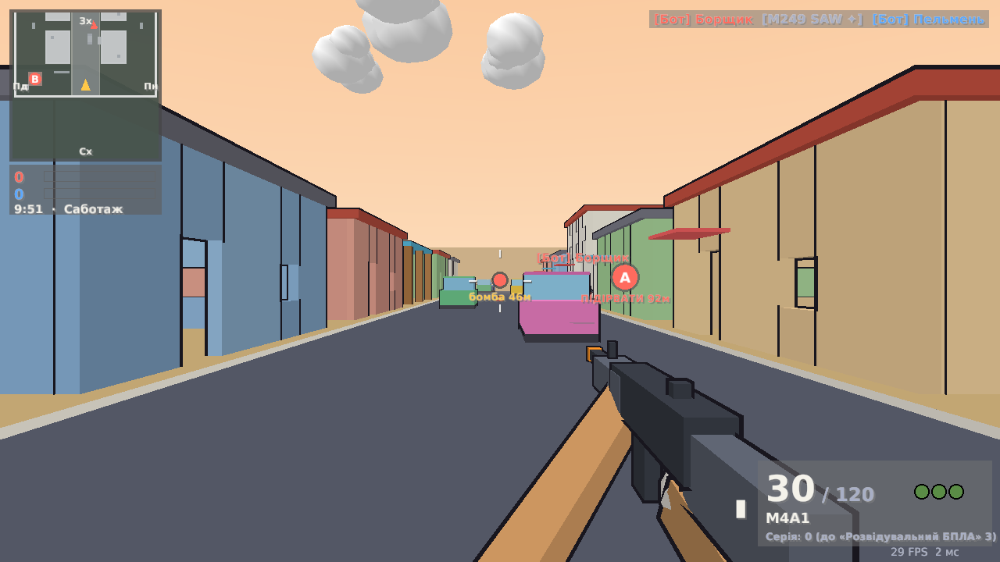

# 🎯 Toon Warfare

Мультиплеєрний шутер від першої особи з геймплеєм у дусі **Call of Duty 4: Modern Warfare**
(класи, перки, кілстріки, ADS, спринт, присід/лежання, гранати, ніж, регенерація здоров'я,
мінімапа з радаром) — але з **мультяшною** графікою: великі голови, яскраві шоломи кольору команди,
чорні контури, toon-освітлення.

Написано на **Rust**: нативний клієнт на [macroquad](https://github.com/not-fl3/macroquad)
(OpenGL 2 / GLES 2 — працює навіть на старих інтегрованих відеокартах) та авторитарний
**виділений сервер**, який будь-хто може запустити у себе та адмініструвати.

Режими:

* **Командний бій (TDM)** — дві команди, перемагає та, що першою набере ліміт вбивств
  (за замовчуванням 75) або матиме більше вбивств, коли вийде час.
* **Саботаж (Sabotage)** — як у CoD4: одна нейтральна бомба в центрі карти. Будь-яка команда
  підбирає її і несе на **ворожу** точку (A — база Морпіхів, B — база Опфору). Закладання 5 с,
  таймер бомби 30 с (час раунду в цей момент зупиняється), захисники можуть знешкодити (5 с) —
  тоді бомба переходить до них. Бомбу на землі (носій загинув) може підібрати **будь-яка** команда. Якщо час раунду вийшов — **овертайм** (sudden death): відродження
  вимкнене, перемагає команда, що підірве ціль, знешкодить бомбу або знищить суперників.
  Над союзником, який несе бомбу, видно іконку бомби з написом «ПРИКРИЙ» і відстанню (навіть крізь
  стіни), щоб команда знала, кого прикривати; ворожого носія не підсвічено.
  Гра йде до N виграних раундів (типово 2).



## Зміст

* [Швидкий старт](#швидкий-старт)
* [Керування](#керування)
* [Класи, перки, кілстріки](#класи-перки-кілстріки)
* [Фізика зброї та тонке налаштування](#фізика-зброї-та-тонке-налаштування)
* [Виділений сервер](#виділений-сервер)
* [Оновлення](#оновлення)
* [Адміністрування](#адміністрування)
* [Швидкодія на слабких ПК](#швидкодія-на-слабких-пк)
* [Архітектура](#архітектура)
* [Розробка й тести](#розробка-й-тести)

## Швидкий старт

### Готові збірки

На сторінці **Releases** репозиторію лежать архіви для Windows, Linux і macOS (Apple Silicon):
`toon-warfare` (гра) та `toon-server` (виділений сервер). Гра з релізу сама знаходить і ставить
оновлення (див. [Оновлення](#оновлення)). Збірки кожного коміту — у вкладці **Actions → build**.

### Збірка з вихідного коду

1. Встановіть Rust: <https://rustup.rs>
2. Лише на Linux потрібні системні бібліотеки:
   ```sh
   sudo apt install libasound2-dev libx11-dev libxi-dev libgl1-mesa-dev
   ```
3. Зберіть:
   ```sh
   cargo build --release
   ```
   Бінарники з'являться в `target/release/`: `toon-warfare` (`.exe` на Windows) та `toon-server`.

### Грати

* **Приєднатися**: запустіть `toon-warfare`, введіть ім'я та адресу сервера (`IP:порт`,
  порт за замовчуванням `27015`) → «Під'єднатися». Кнопка «Знайти сервери» шукає сервери
  в локальній мережі.
* **Створити сервер прямо з гри**: «Створити сервер» → налаштуйте режим, карту, ботів,
  RCON-пароль → «Запустити». Друзі приєднуються за вашим IP (у меню показано локальну адресу).
  Для гри через інтернет відкрийте/пробросьте порт (див. нижче).
* **Обрані сервери**: зірочка ☆ біля адреси на головній сторінці додає сервер в обрані, а в
  «Знайти сервери» обрані стоять першими (навіть ті, що зараз не відповідають, — щоб їх можна
  було прибрати). Там же можна додати сервер за IP чи доменом. Домен лишається доменом.
* **Мова**: українська або англійська (English) — «Налаштування» → «Мова / Language» (або
  `--lang uk|en`). При першому запуску береться мова системи. Сервер пише кожному гравцеві його
  мовою (повідомлення, відмови, перемоги), тож на одному сервері можуть грати люди з різними мовами.
* Без друзів? На сервері є **боти** — вони заповнюють команди до вказаної кількості гравців
  і самі виходять, коли приєднуються люди.

### Боти та складність

Складність задається від 0 до 1 або назвою: `easy` (легкі), `normal` (звичайні, типово),
`hard` (важкі), `veteran` (ветерани). Кожен бот трохи відхиляється від загального рівня,
а зміна в адмінці (`set botskill hard`) діє одразу, без перезапуску.

* **Бачать лише перед собою** (поле зору 100–150°) і помічають ворога **не миттєво**: довше,
  якщо він далеко, на краю поля зору, присів, лежить або стоїть на місці; швидше, якщо стріляє.
  Ворога за спиною не бачать. Вони **чують** постріли й кроки (крім перка «Мертва тиша»)
  і повертаються на звук.
* **Промахуються**: у легких велика похибка, яка ніколи не зникає (тремтіння руки), повільна
  реакція, відставання при стрільбі по рухомій цілі, гірше тримають віддачу. Віддача й розкид
  у русі діють на ботів так само, як на гравців.

Виміряно в тестах (поєдинок з ворогом, що рухається вбік):

| | легкі | звичайні | важкі | ветерани |
|---|---|---|---|---|
| влучання на 10 м | 13% | 44% | 64% | 73% |
| влучання на 25 м | 3% | 23% | 66% | 68% |
| помічання ворога на 20 м | 2,3 с | | | 0,4 с |

### Де з'являються гравці

Раунд і матч починаються на базах команд. Посеред гри гравця відроджує будь-де на рівні землі
(серед ~50 випадкових точок і точок баз): не ближче ніж 12 м до ворогів і поза їхнім полем зору,
подалі від місць недавніх смертей і від того, хто щойно з'явився поруч. У командному бою — ближче до
своїх, у «Саботажі» — на своїй половині карти.

### Захист після відродження

Після відродження гравець кілька секунд невразливий (типово 3 с, `spawn_protection`
у конфігу або `set spawnprotect 3`; `0` вимикає захист).

* **Із захистом атакувати не можна**: ні стріляти, ні кидати гранату, ні бити ножем, ні викликати
  кілстрік (це перевіряє сервер). Хочете битися раніше — натисніть **ЛКМ**: захист зникне
  (без пострілу), і за мить можна стріляти.
* Щит навколо гравця бачать **лише союзники**. Ворогам сервер узагалі не передає цю інформацію,
  тож захищеного гравця не видно здалеку.
* Сам гравець бачить на екрані відлік захисту. Боти не атакують захищених гравців і, як люди,
  знімають власний захист, коли помічають ворога.

### Карти

| Ключ | Назва | Натхнення | Особливості |
|---|---|---|---|
| `wreck` | Аварія | Crash | збитий гелікоптер у центрі, триповерхова вежа з дахом-позицією, будинки з балконами й виходом на дах, ринкові ятки, колодязь, пікапи, низькі стіни з колонами, бордюри, пальми |
| `site` | Будмайданчик | Crossfire / Backlot | недобудований бетонний каркас з дірою в перекритті та риштуванням, баштовий кран, піддони з цеглою, вагончики й туалети, сині паркани, офісна вежа з балконом, автостоянка, склад |
| `depot` | Депо | — | склади, контейнери, двоповерхові будинки |
| `market` | Ринок | Backlot | великий район 200×104 м: головна вулиця через ринкову площу з рядами прилавків, возами й фонтанами; ряди крамниць і будинків з провулками, задні провулки з білизною на мотузках, склади, дворики-точки Саботажу, автостанції на кінцях; драбини на дахи крамниць і складів |
| `cargo` | Вантаж | — | порт із контейнерами |

Боти вміють ходити сходами й драбинами, підніматися на дахи й балкони та зістрибувати вниз.

* **Драбини**: підійдіть і тисніть `W` — лізете туди, куди дивитесь (до стіни — вгору, від стіни —
  вниз), `S` — навпаки, `A/D` — убік, `Space` — зіскочити. Нагорі `W` переводить на дах; з даху
  на драбину можна просто зійти.
* **Прострілювані матеріали**: тканина (тенти, навіси, білизна на мотузках) і тонке дерево
  (прилавки, вози, паркани з дощок) не зупиняють кулі. Крізь тканину не видно, але куля
  проходить майже без втрат (×0,95 урону) і крізь неї можна пройти; дошки тримають гравців,
  а кулю послаблюють (×0,7). Цегла, бетон і метал кулі зупиняють. Видно тріски й клапті.

### Кілкам, регдоли, звук

* **Кілкам** — після смерті через секунду повтор останніх ~4 с очима того, хто тебе вбив: його зброя,
  приціл (зі снайперської — через оптику), постріли й хітмаркери. ЛКМ — пропустити й відродитися.
* **Фінальний кілкам** — наприкінці матчу (і раунду Саботажу) всі дивляться останнє вбивство,
  у момент пострілу повтор сповільнюється.
* **Регдоли** — тіла падають від влучання, вибухи їх підкидають, зброя випадає.
* **Підбирання зброї** — убитий гравець кидає зброю з рук. Підійди й натисни **F**, щоб обміняти
  свою поточну зброю (твоя ляже на її місце, з набоями, що лишились). Якщо в тебе така сама зброя —
  достатньо пройти поруч, набої заберуться самі. Зброя лежить 40 с.
* **Тіні й текстури** — сонце відкидає тіні від будинків, контейнерів і риштувань (карта тіней
  рендериться один раз при завантаженні карти, тож майже нічого не коштує в кадрі), поверхні мають
  процедурні текстури: цегла, черепиця, дошки, штукатурка, пісок, асфальт, профнастил. Обидва ефекти
  вимикаються в налаштуваннях («Тіні», «Текстури») для дуже слабких ПК.
* **Персонажі** — анімовані мультяшні бійці з паку Quaternius (CC0): велика голова в касці,
  ходьба, біг і дихання на місці, тулуб і голова стежать за прицілом, руки тримають зброю (IK),
  у присіді коліна згинаються, лежачи — груди підведені. Скінінг на CPU з «запеченим» тоновим
  світлом, тож навіть слабкий GPU малює лише кольорові трикутники. Кожна команда має свою форму,
  відтінок шкіри різний, навколо кожного — **контур кольору команди**, що ширшає з відстанню.
  Регдоли рухають ту саму модель. Хітбокси підігнано під моделі (є тест).
* **Зброя** — кожна з 15 гармат має впізнаваний силует (ручка M4, дерев'яний AK з вигнутим
  магазином, булпап P90, короб M249 і барабан RPD із сошками, оптика M40A3/R700, сріблястий Desert
  Eagle). Усі моделі разом: `toon-warfare --model-gallery`.
* **Димова граната** (`Q`, одна на життя) — через 1,6 с розпускається мультяшна хмара ~10 м
  завширшки й тримається 18 с. Крізь неї нічого не видно: ні гравців, ні імен ворогів, ботів теж
  (вони не бачать крізь дим, а носій бомби в «Саботажі» сам кидає дим перед точкою). На мінікарті
  хмара — сіре коло.
* **Звук** синтезується при запуску (без файлів, ~0,2 с), у стерео й паралельно на всіх ядрах (~0,3 с): кожна з 15 гармат звучить
  по-своєму (надзвуковий «тріск» кулі, дульний вибух через резонансні фільтри, удар у груди,
  клацання затвора), а вулиця відповідає — реверберація згорткою з «оксамитовим шумом» (без металевих
  резонансів), де високі частоти згасають першими. Далекі постріли — глухий гул з луною, вибухи — тріск, рев, рокіт і
  уламки. Перезарядка, гільзи, кроки, свист куль (зліва/справа), гелікоптер, «ой» при пораненні.
  Будь-який звук можна замінити справжнім записом: поклади `.ogg`/`.wav` у `assets/sounds/`
  (назви — у `assets/sounds/README.md`); биті файли пропускаються.
* **Записані звуки зброї** (вбудовані в гру, ~1,3 МБ OGG): постріли M4A1, AK-47, MP5, P90, M249, RPD,
  R700, M40A3, M9, USP і Desert Eagle — по кілька дублів, що чергуються, вирівняні за гучністю з
  рештою. Кожна зброя може мати власну перезарядку (`mag_out_<зброя>`, `mag_in_<зброя>`,
  `bolt_<зброя>`): записані є в AK-47/AK-74u, MP5, P90, M249, RPD і затвор USP; решта — синтез.
  Синтезом лишились G3, дробовики й інші звуки. Нарізка з вихідних записів — `tools/cut_sounds.py`.

## Керування

| Дія | Клавіша |
|---|---|
| Рух | `W A S D` |
| Біг (спринт) / затримати дихання в снайперському прицілі | `Shift` |
| Стрибок | `Space` |
| Присісти / лягти | `C` / `Ctrl` (або `Z`) |
| Стріляти / прицілитися (ADS) | `ЛКМ` / `ПКМ` |
| Перезарядка | `R` |
| Основна / додаткова зброя | `1` / `2` / коліщатко |
| Граната (тримайте, щоб «приготувати») | `G` |
| Димова граната (одна на життя) | `Q` |
| Ніж | `V` |
| Дія: закласти / знешкодити бомбу | тримати `F` |
| Використати кілстрік | `5` (або `4`) |
| Таблиця рахунку | `Tab` |
| Чат: всім / команді | `T` / `Y` |
| Змінити клас | `M` |
| Меню (клас, команда, налаштування, вихід) | `Esc` |

## Класи, перки, кілстріки

**Зброя** (урон спадає з відстанню, хедшоти ×1.4, ноги ×0.85):
штурмові M4A1, AK-47, G3 · ПП MP5, P90, AK-74u · кулемети M249 SAW, RPD ·
дробовики W1200, M1014 · снайперські M40A3, R700 (оптичний приціл, коливання, затримка дихання) ·
пістолети M9, USP .45, Desert Eagle.

**Класи за замовчуванням**: Штурмовик, Спецназ, Кулеметник, Підривник, Снайпер +
**3 власні класи** (редактор у меню вибору класу, зберігаються локально).

**Перки**

| Тир 1 | Тир 2 | Тир 3 |
|---|---|---|
| Фраг ×3 — три гранати | Зупиняюча сила — +40% урону | Стійкий приціл — точніша стрільба від стегна |
| Бандольєр — більше набоїв | Джаггернаут — −25% вхідного урону | Екстремальна підготовка — спринт ×2 |
| | Спритність рук — перезарядка ×2 швидше | Мученик — після смерті падає граната |
| | Глушилка БПЛА — невидимий для ворожого БПЛА | Мертва тиша — беззвучні кроки |

**Кілстріки** (серія вбивств без смерті):

* **3** — радар: 30 с усі вороги видно на мінімапі.
* **6** — авіаудар: обираєте ціль на карті, три літаки скидають бомби.
* **9** — артилерія: обираєте ціль на карті, за 3 с на круг ~9 м один за одним лягають 14 снарядів
  (на мінімапі — пульсуюче червоне коло, чути свист).
* **12** — гелікоптер: 50 с кружляє над картою й атакує ворогів; його можна збити.
* **15** — FPV-дрон: злітає над головою й зависає, далі керуєте від першої особи як квадрокоптером:
  W/S — вперед (куди дивитесь)/назад, A/D — вбік, Пробіл/Ctrl — вгору/вниз, Shift — газ; без клавіш
  гальмує до зависання. Вибух від ЛКМ/E, від удару об тверду поверхню (стіна, земля, дах — уже
  від ~11 км/год; лише ледь торкнутися чи ковзнути вздовж стіни можна без наслідків) або коли поруч
  ворог; якщо врізатися до зведення заряду, дрон просто розбивається без вибуху; батареї 30 с, перші 0,7 с заряд не зведений. Відеозв'язок слабшає
  з відстанню й за масивними будівлями між дроном і вашим солдатом — сніг, рвані рядки, сіра пелена,
  шкала сигналу.
* **18** — дрон-бомбер: 45 с на висоті 19 м, вигляд згори, червоне коло показує, куди впаде бомба;
  6 бомб (ЛКМ/Пробіл), E — вийти.
* **21** — НРК (наземний робот з кулеметом, 60 с): після активації оберіть **«Керувати самому»**
  (від третьої особи, WASD + ЛКМ/Пробіл) або **«Автономний»** — він сам їде мапою, шукає ворогів і
  стріляє (не бачить крізь дим).

Поки ви керуєте технікою, ваш боєць стоїть на місці й беззахисний; якщо його вб'ють — техніка зникає
(автономний НРК воює далі). Техніку можна збити кулями й вибухами. Власні кілстріки вас не ранять.
Нагороди йдуть по колу: після НРК (21) серія продовжується, і на 24 вбивствах знову дається радар,
на 27 — авіаудар і так далі.

Як у CoD4: постріл без глушника показує вас червоною точкою на ворожому радарі.

## Фізика зброї та тонке налаштування

Кожна зброя поводиться по-своєму, і все це налаштовує адміністратор сервера:

* **Вага (кг)** дає інерцію: з кулеметом (8 кг) персонаж повільніше розганяється й гальмує,
  ніж з ПП (2,7 кг) чи пістолетом. До того ж нижчі **швидкість ходьби й спринту**
  (`move_mult`, `sprint_mult`), повільніше **прицілювання** (`ads_time`) і **діставання**
  (`swap_time`), а після спринту зброя довше піднімається, перш ніж можна стріляти (`sprint_out_time`).
* **Віддача** наростає під час довгої черги (`recoil_ramp`, `recoil_max_ramp`) і поступово
  повертається після неї (`recoil_recover`). Кулемет стабільніший лежачи, як на сошках
  (`prone_recoil`), і в присіді (`crouch_recoil`). Розкид росте з кожним пострілом
  і відновлюється з власною швидкістю.
* **Коливання прицілу** (`sway`): у важкої та снайперської зброї сильніше, у присіді
  й лежачи менше. Снайпер може затримати дихання (`Shift`).
* **Рух персонажа:** окремі швидкості ходьби, спринту, присіду й лежання. Назад і вбік рух
  повільніший. Окремо задаються розгін, гальмування, розгін до спринту, керування в повітрі,
  гравітація, стрибок, тривалість і відновлення спринту, розгойдування камери.
* **Стрейф-джамп, як у CoD4:** у стрибку тримайте `A` чи `D` і плавно ведіть мишку в той самий бік —
  швидкість трохи зростає (до ×1,12 від спринту, у межах серверної перевірки руху). Просто тримати
  клавішу чи вести мишку не туди майже нічого не дає; у повітрі ніщо не гальмує, тож розгін
  зберігається до приземлення. Налаштування: `movement.air_strafe_accel`, `movement.strafe_jump`.

Сервер надсилає ці налаштування кожному гравцеві, тож передбачення руху на клієнті збігається
з сервером, і ривків чи «відкидань» немає. Зміни діють **миттєво, без перезапуску**.

Як налаштувати:

* **Веб-панель** → «Тонке налаштування: рух і зброя»: оберіть «Рух персонажа» або зброю
  і змініть числа. Біля кожного поля — опис і допустимий діапазон. Далі «Застосувати»,
  а щоб зміни лишились після перезапуску, «Зберегти у файл».
* **Консоль** або `/rcon` у грі:
  ```text
  tune movement                    # усі параметри руху з поясненнями й діапазонами
  tune weapons                     # уся зброя: вага, темп, мобільність, час прицілювання
  tune m249                        # усі параметри кулемета
  tune movement.sprint_speed 8.2   # швидший спринт для всіх
  tune m249.weight 11              # кулемет ще важчий (повільніший розгін)
  tune m249.rpm 850                # темп стрільби
  tune mp5.ads_time 0.15           # швидший приціл у MP5
  tune grenade                     # гранати: дальність, запал, радіус, урон, відскок
  tune grenade.throw_speed 22      # гранати летять далі (дальність ≈ швидкість² / гравітація)
  tune streaks                     # кілстріки: пороги вбивств, урон, тривалість, швидкості
  tune streaks.heli_kills 10       # гелікоптер уже за 10 вбивств
  tune streaks.fpv_blast_damage 300
  tune w1200.auto true             # автоматичний дробовик
  tune reset m249                  # повернути заводські (або movement / grenade / streaks / all)
  save                             # записати в server.json
  ```
* **`server.json`**, розділ `tuning`: сервер записує туди всі значення, і їх можна редагувати
  напряму. Достатньо вказати лише те, що змінюєте, решта береться із заводських:
  ```json
  "tuning": {
    "movement": { "sprint_speed": 8.0, "ground_accel": 45 },
    "weapons": { "m249": { "weight": 10, "move_mult": 0.75 } }
  }
  ```

Ключі зброї: `m4 ak47 g3 mp5 p90 ak74u m249 rpd w1200 m1014 m40 r700 m9 usp deagle`.

**Гранати** (`tune grenade`, розділ «Гранати» у веб-панелі, `tuning.grenade` у конфігу):

| Ключ | Що робить | Типово |
|---|---|---|
| `throw_speed` | швидкість кидка — **головний параметр дальності** | 17 м/с |
| `throw_arc` | додатковий кут кидка вгору, ° | 10 |
| `inherit_velocity` | яка частка швидкості бігу передається гранаті | 0.5 |
| `fuse` | запал, с | 3.5 |
| `radius` / `damage` | радіус вибуху (м) / урон в епіцентрі | 6.5 / 150 |
| `bounce` | пружність відскоку (0 — граната «прилипає») | 0.4 |

**Кілстріки** (`tune streaks`, розділ «Кілстріки» у веб-панелі, `tuning.streaks` у конфігу):
для кожної нагороди — скільки вбивств поспіль вона коштує (`uav_kills`, `airstrike_kills`, …,
`nrk_kills`; коло нагород — до найбільшого з порогів, потім з початку) і її сила:
радар — `uav_time`; авіаудар — `airstrike_bombs/_radius/_damage/_delay`; артилерія —
`artillery_shells/_radius/_damage/_spread/_delay/_interval`; гелікоптер — `heli_time/_health/
_damage/_fire_interval/_spread`; FPV — `fpv_time/_health/_speed/_boost/_blast_radius/
_blast_damage/_crash_speed/_arm_time`; бомбер — `bomber_time/_health/_speed/_bombs/_cooldown/
_drop_radius/_drop_damage`; НРК — `nrk_time/_health/_speed/_damage/_fire_interval/_spread`.
Повний список з поясненнями й діапазонами — `tune streaks`.

Виміряно в тесті (кидок по рівній дорозі): граната зупиняється за 5 м при `throw_speed 9`,
11,5 м при 17 (типово) і 21 м при 26. Боти рахують траєкторію під поточну швидкість кидка.
Неправильні значення автоматично обмежуються допустимим діапазоном.

## Виділений сервер

```sh
./toon-server                       # створить server.json з налаштуваннями за замовчуванням
./toon-server --config my.json --port 27015 --rcon МійПароль --bots 6
./toon-server --map cargo --mode sab
```

Сервер використовує **один номер порту**: **UDP** для гри та **TCP** для веб-панелі
(`http://<сервер>:27015/` — публічна сторінка зі статусом, `/admin` — адмінка).
Для гри через інтернет відкрийте/пробросьте на роутері **UDP і TCP 27015**
(TCP потрібен лише для веб-адмінки). Брандмауер Linux:

```sh
sudo ufw allow 27015/udp
sudo ufw allow 27015/tcp
```

### `server.json`

Приклад — [`server.example.json`](server.example.json). Основні поля:

| Поле | Опис |
|---|---|
| `name`, `motd` | назва сервера і привітання |
| `bind`, `port` | адреса і порт (UDP гра + TCP веб) |
| `max_players` | максимум гравців (до 32) |
| `password` | пароль для входу (порожньо — відкритий сервер) |
| `rcon_password` | пароль адміністратора (порожньо — веб-адмінка і `/rcon` вимкнені) |
| `rotation` | список `{ "map": "wreck|site|depot|market|cargo", "mode": "tdm|sab" }` |
| `tdm.score_limit`, `tdm.time_limit` | ліміт вбивств і час (хв) для Командного бою |
| `sab.time_limit`, `sab.rounds_to_win`, `sab.bomb_timer`, `sab.plant_time`, `sab.defuse_time`, `sab.overtime_limit` | налаштування Саботажу |
| `friendly_fire`, `auto_balance` | вогонь по своїх, автобаланс команд |
| `bots`, `bot_skill` | заповнювати ботами до N гравців; складність 0..1 (0.1 легкі, 0.4 звичайні, 0.7 важкі, 1 ветерани) |
| `spawn_protection` | секунди невразливості після відродження (0 = вимкнено) |
| `min_players` | скільки гравців потрібно, щоб почався матч (до того — розминка) |
| `http_enabled` | вмикає веб-сторінку та адмінку |
| `require_same_version` | пускати лише гравців з тією ж версією гри, що й сервер (`true`; див. [Оновлення](#оновлення)) |
| `data_dir` | де зберігати `bans.json` |
| `tuning` | рух і параметри кожної зброї (див. [Фізика зброї](#фізика-зброї-та-тонке-налаштування)) |

### Docker

```sh
docker build -t toon-server .
docker run -d --name toon -p 27015:27015/udp -p 27015:27015/tcp \
  -v $PWD/server-data:/data toon-server
# конфіг: server-data/server.json (створиться автоматично)
```

### systemd

Приклад юніта — [`deploy/toon-server.service`](deploy/toon-server.service).

## Оновлення

**Випуск нової версії.** Позначте коміт тегом і запуште його:

```sh
git tag v0.2.0
git push origin v0.2.0
```

CI збере гру й сервер для Windows, Linux і macOS і опублікує **GitHub Release** `v0.2.0`:
архіви для людей і окремі файли `toon-warfare-<система>` / `toon-server-<система>` для
вбудованого оновлювача. Номер версії береться з тега й вшивається у збірку.

**Оновлення сервера.**

```sh
./toon-server --check-update   # чи вийшла новіша версія
./toon-server --update         # завантажити її замість цього файлу
sudo systemctl restart toon-server
```

Сервер з релізу й сам пише в консоль, коли виходить нова версія. Docker-образ оновлюється
перезбиранням (`docker build`).

**Оновлення гравців — автоматично.** Гра з релізу при запуску питає GitHub про останній реліз.
Якщо він новіший, у меню справа вгорі з'являється «Доступне оновлення vX» з кнопкою
**«Оновити»**: гра завантажує нову версію, замінює свій файл і перезапускається з тими самими
параметрами. Сервер пускає лише гравців з тією ж версією гри (`require_same_version`), тож
після оновлення сервера гравець зі старою версією бачить «Версія гри не збігається…» і ту саму
кнопку — один клік, і він у грі.

* Перевірку вимикає `--no-update`. Збірки з вихідного коду не шукають оновлень при запуску,
  але пропонують кнопку, коли сервер просить оновитися.
* Версія збірки з вихідного коду — найвищий тег `v*` в історії поточного коміту (`git fetch
  --tags`, щоб вони були локально). Тож сервер, зібраний `cargo build --release` після
  `git pull` на коміті з тегом `v0.2.1`, теж вважає себе 0.2.1. Якщо старішим виявився сервер,
  гравець бачить «Сервер старіший за твою гру…» — оновлювати тоді треба сервер.
* Якщо файл гри лежить у теці без права запису (наприклад, `Program Files`), оновлення
  повідомить про це — тоді треба завантажити архів вручну.
* `TOON_UPDATE_URL` — інша адреса з тим самим JSON, що й `api.github.com/.../releases/latest`
  (дзеркало або тест).
* Номер протоколу (`PROTOCOL_VERSION`) все одно варто піднімати, коли змінюються мережеві
  повідомлення: так навіть сервер з `require_same_version: false` не пустить несумісний клієнт.

## Адміністрування

Три способи, всі використовують однакові команди:

1. **Консоль сервера** — просто вводьте команди у вікні `toon-server`.
2. **Веб-панель** — `http://<сервер>:<порт>/admin`, вхід за `rcon_password`: список гравців
   (кік, бан, переведення в команду, вбити), зміна карти/режиму, наступна карта, перезапуск,
   налаштування (ліміти, боти, вогонь по своїх, автобаланс), повідомлення всім, консоль, бани, журнал.
3. **З гри** — у чаті: `/rcon login <пароль>`, потім `/rcon <команда>`.

| Команда | Дія |
|---|---|
| `status` | стан сервера, список гравців з IP і пінгом |
| `say <текст>` | повідомлення всім |
| `kick <id\|ім'я> [причина]` | вигнати |
| `ban <id\|ім'я> [причина]` / `unban <ip>` / `banlist` | бани за IP (зберігаються у `data/bans.json`) |
| `map <карта> [режим]` / `mode <tdm\|sab>` / `nextmap` / `rotation` | карти і режими |
| `restart` / `endround` | перезапустити / завершити матч |
| `team <id\|ім'я> <allies\|axis\|spec>` / `kill <id\|ім'я>` | керування гравцем |
| `bots <n>` / `addbot` / `kickbots` | боти |
| `tune …` | тонке налаштування руху і кожної зброї (див. розділ вище) |
| `givestreak <id\|ім'я> <radar\|airstrike\|artillery\|heli\|fpv\|bomber\|nrk>` | видати кілстрік |
| `givebomb <id\|ім'я>` | дати бомбу живому гравцю (Саботаж) |
| `set <ключ> <значення>` | `scorelimit`, `timelimit`, `sabtime`, `rounds`, `bombtimer`, `planttime`, `defusetime`, `ff`, `autobalance`, `maxplayers`, `password`, `name`, `motd`, `botskill` |
| `save` | зберегти поточні налаштування в конфіг |

> ⚠️ Веб-панель працює по HTTP без шифрування. Для керування через інтернет поставте перед нею
> HTTPS-проксі (nginx/Caddy) або відкривайте TCP-порт лише для своїх IP. Після 5 невдалих спроб
> входу IP блокується на хвилину.

## Швидкодія на слабких ПК

* Рендер — OpenGL 2 / GLES 2, освітлення «запечене» у вершини (без складних шейдерів),
  геометрія карт — прості бокси, сотні трикутників на персонажа.
* **Налаштування → «Масштаб рендеру»**: 3D малюється у зменшеній роздільності й масштабується
  (HUD лишається чітким). 50–70% дуже допомагає старим інтегрованим відеокартам.
* **«Мультяшні контури»** можна вимкнути — це вдвічі менше трикутників.
* **FPS застряг на 60?** Це вертикальна синхронізація (vsync): кадри прив'язані до частоти
  монітора. Вимкніть «Вертикальна синхронізація» в налаштуваннях і перезапустіть гру. Тоді
  з'явиться «Обмеження FPS» (60 / 120 / 144 / 165 / 240 / без обмеження). На моніторі 60 Гц
  більше 60 кадрів ви не побачите, але затримка керування стане меншою (можливі «розриви» кадру).
  Разовий запуск без vsync: `toon-warfare --no-vsync`. Реальний FPS і найдовший кадр за секунду в консолі: `--log-fps`.
* **Плавність прицілу**: «Згладжування миші» (типово увімкнено) усереднює рух миші за два кадри, коли
  частота опитування миші (125–1000 Гц) не збігається з FPS і камера інакше йде дрібними сходинками.
  Для найплавнішого руху потрібен рівний FPS: vsync або обмеження FPS трохи нижче за той, який ПК
  тримає стабільно, а на слабких ПК — менший «Масштаб рендеру».
* Камера плавно проходить сходи, зміну стійки й дрібні корекції позиції від сервера,
  тож ривків немає навіть при 60 FPS.
* Сервер дуже легкий: ~2 МБ бінарник, кілька МБ пам'яті, 30 тіків/с.

## Архітектура

```text
crates/
  shared/   спільна логіка: константи, tuning.rs (параметри руху і зброї), зброя/перки/класи, карти (генерація боксів),
            фізика руху (AABB + сітка), рейкасти й хітбокси, протокол, надійний UDP-канал
  server/   виділений сервер (бібліотека + бінарник toon-server):
            game.rs (стан, матч, спавни, валідація руху, снапшоти), combat.rs (стрільба,
            лаг-компенсація, гранати, ніж, кілстріки, гелікоптер), sab.rs (Саботаж),
            bots.rs + nav.rs (боти, A*), admin.rs (команди, бани), http.rs + web/ (адмінка),
            netserver.rs (UDP-цикл)
  client/   гра toon-warfare: game.rs (передбачення руху, зброя, інтерполяція), render.rs,
            models.rs (мультяшні моделі), mesh.rs (toon-шейдинг, контури, туман), hud.rs,
            menu.rs, audio.rs (синтезовані звуки), effects.rs
```

* **Сервер авторитарний** щодо здоров'я, влучань, набоїв, рахунку, бомби, кілстріків.
* Рух — **передбачення на клієнті** тією самою фізикою (`shared/physics.rs`) +
  серверна перевірка швидкості/стін з корекцією позиції.
* Влучання — **хітскан на сервері з лаг-компенсацією**: позиції гравців перемотуються на
  `пінг/2 + 100 мс` назад (історія 30 тіків/с).
* Мережа — UDP, власний легкий надійний канал (ack + повтор) для подій і ненадійні
  снапшоти 30 Гц; інші гравці інтерполюються із затримкою 100 мс.

## Розробка й тести

```sh
cargo test --release
```

* `shared`: фізика (ходьба, стіни, сходи, стрибок, стійки, спавни на всіх картах), рейкасти/хітбокси,
  падіння урону, надійний канал з втратою пакетів.
* `server`: досяжність цілей A* на всіх картах; симуляції матчів ботами (TDM та Саботаж: вбивства,
  закладання бомби, перемога в раунді); адмін-команди; наскрізний тест по справжньому UDP
  (підключення, команда/клас, рух без корекцій, постріл).
* `client`: синтез усіх звуків (без NaN і перевантаження).

Для автоматичних скріншотів у клієнта є `--auto --team allies|axis|spec`, `--screenshot файл.png`,
`--screenshot-after секунди`, `--screenshot-killcam секунди` (знімок посеред кілкаму) і
`--score-limit N` (короткий матч на локальному сервері).

План і перелік задач — у [PLAN.md](PLAN.md).

Шрифти DejaVu — вільна ліцензія (див. [assets/fonts/LICENSE](assets/fonts/LICENSE)).
