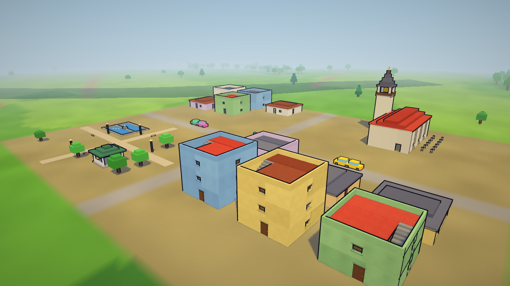
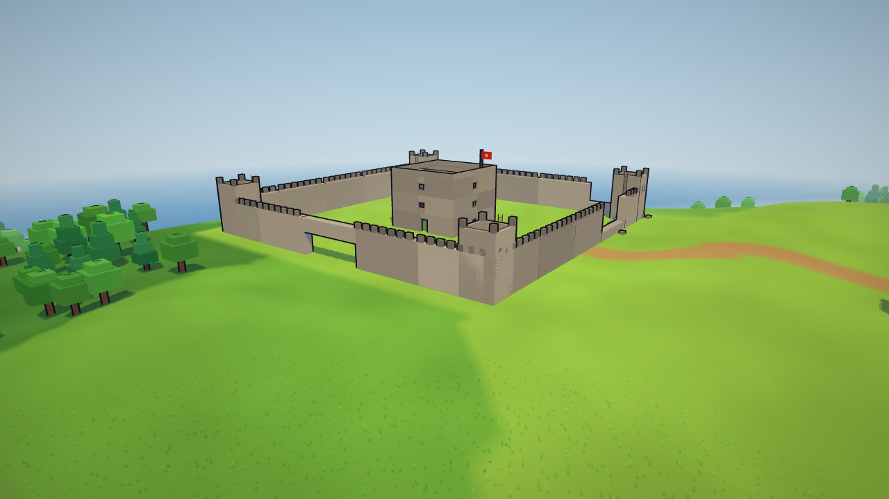

# 🎯 Toon Warfare

A multiplayer first-person shooter with **cartoon** graphics: team deathmatch, Sabotage and a
**battle royale** on a 2×2 km island. It has 22 guns from pistols to an RPG and a bow,
killstreaks, a world that breaks apart under explosions, and bots that see and hear the way
a player does. Written in **Rust**, it runs even on weak PCs (OpenGL 2) and comes with a
dedicated server.



**Full guide**: every rule and setting, the server, administration and the architecture, in
[docs/GUIDE.en.md](docs/GUIDE.en.md) (in Ukrainian: [docs/GUIDE.md](docs/GUIDE.md)).

## Modes

* **Team deathmatch**: two teams; the first to the kill limit wins.
* **Sabotage**: one bomb. Carry it to the enemy's site and blow it up, or defuse theirs. When
  time runs out, a ten-second countdown and a siren start the overtime with no respawns.
* **Battle royale**: up to 64 players on the Island. Jump from the plane, find loot, stay
  inside the shrinking zone and the last one alive wins. You can play solo, in duos or in
  squads of four. Cars and boats, supply drops, attachments and scopes up to 8×, weather from
  clear days to fog and night.

**Maps:** Wreck, Construction Site, Depot, Market, Cargo, and the **Island**. The Island has
themed towns, a port, ranches, a sawmill, a mine, a castle, a lighthouse, a harbour and a few
secrets to find.

## What makes it play

* **22 guns in 8 kinds**:
  * assault rifles, SMGs, marksman rifles, machine guns and shotguns;
  * sniper rifles with 8–12× optics and a holdover ladder;
  * pistols;
  * an **RPG-7**, a **crossbow** and a **bow** you draw by holding the trigger.

  Real ballistics: bullets fly at their own speed and drop. The .50 and 14.5 mm rifles go
  through thin walls.
* **Your loadout** is one screen with every gun on it, plus your choice of grenades: frag or
  molotov, smoke or flashbang. There are no perks: the gun and your hands decide.
* **Destruction**: explosions punch ragged holes in walls. Roofs left without support come
  down as climbable rubble, trees, posts and cranes fall over, and the ground keeps its
  craters. The server and every client work this out the same way.
* **Bots** see only in front of them, notice you late if you are far, crouched or still,
  hear gunfire and footsteps, and read your movement with a human delay. A sharp turn makes
  them miss. Four difficulties from easy to veteran.
* **Between matches**:
  * the match's MVP and up to nine awards: longest shot, best streak, most accurate and more;
  * its **best moments** replayed through the shooter's eyes;
  * a countdown to the next map.
* **Killcams**, ragdolls, positional sound, Apex-style pings, squads and parties, and player
  leaderboards.



## How to play

1. Download the game for Windows, Linux or macOS from **Releases**. It updates itself.
2. Run `toon-warfare`. Press **PLAY** for a public game, enter a server's address
   (`IP:27015`), or press **Host a server** to play with bots or friends.
3. If the game runs slowly: **Settings → Video → "Low"**.

| Action | Key |
|---|---|
| Move / sprint / jump | `W A S D` / `Shift` / `Space` |
| Crouch / go prone | `C` / `Ctrl` |
| Fire / aim | `LMB` / `RMB` |
| Reload / weapons | `R` / `1` `2` or the wheel |
| Lethal grenade / tactical grenade / knife | `G` / `Q` / `V` |
| Use, pick up, doors, vehicles | `F` |
| Killstreak | `5` |
| Loadout (team modes) | `M` |
| Inventory / map / medkit (battle royale) | `I` / `M` / `H` |
| Ping | `MMB` |
| Scoreboard / chat | `Tab` / `T` |
| Menu | `Esc` |

Every key can be changed in **Settings → Controls**.

## Your own server

```sh
./toon-server                                    # writes server.json on the first run
./toon-server --map island --mode br --bots 30   # a battle royale
```

Open port **27015**: UDP for the game, TCP for the web panel at
`http://<server>:27015/admin`. To update, run `./toon-server --update`. The server page and
the game (Esc → "Leaderboards") show the best players: kills, wins, the longest kill and
more. Settings, Docker and systemd are in the
[guide](docs/GUIDE.en.md#dedicated-server).

## Building

```sh
# Linux: sudo apt install libasound2-dev libx11-dev libxi-dev libgl1-mesa-dev
cargo build --release
cargo test --release
```

The binaries are in `target/release/`: `toon-warfare` and `toon-server`.

## License

Toon Warfare is free software: you can redistribute and change it under the terms of the
[GNU General Public License](LICENSE), version 3 or (at your choice) any later version.
Anyone who distributes a changed version of the game or the server must publish its code
under the same license.

Copyright © 2026 Ytrnfhsy.

Third-party assets (the character models, fonts, some of the sounds, the macroquad engine)
are under their authors' licenses; see [`THIRD_PARTY.md`](THIRD_PARTY.md).
