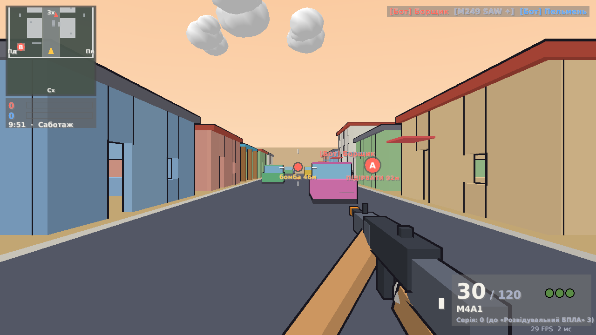

# 🎯 Toon Warfare: the complete guide

[Українською](GUIDE.md) · The game in brief: [README](../README.md).

A multiplayer first-person shooter that plays like **Call of Duty 4: Modern Warfare**
(classes, perks, killstreaks, aiming down sights, sprinting, crouching and lying prone, grenades,
the knife, health that comes back, a minimap with a radar), but with **cartoon** graphics: big
heads, bright helmets in the team's colour, black outlines and toon lighting.

Written in **Rust**: a native client on [macroquad](https://github.com/not-fl3/macroquad)
(OpenGL 2 / GLES 2, so it runs even on old integrated graphics) and an authoritative
**dedicated server** that anyone can run and administer.

Modes:

* **Team deathmatch (TDM)**: two teams; the first to reach the kill limit (75 by default), or
  the one with more kills when time runs out, wins.
* **Sabotage**: as in CoD4, one neutral bomb in the middle of the map. Either team picks it up
  and carries it to the **enemy** site (A is the Marines' base, B OpFor's). Planting takes 5 s,
  the bomb timer is 30 s (the round clock stops meanwhile), and the defenders can defuse it
  (5 s), after which the bomb is theirs. A bomb on the ground (its carrier died) can be picked
  up by **either** team. When the round time runs out it goes to **overtime** (sudden death):
  no respawns, and the team that blows up its target, defuses the bomb or wipes out the other
  side wins. Over a teammate carrying the bomb you see a bomb icon with "COVER" and the
  distance (even through walls), so the team knows whom to cover; an enemy carrier is not
  marked. The game goes on until a team has won N rounds (2 by default).
* **Battle royale (BR)**: every man for himself on the 2×2 km "Island" (hills, a river with
  bridges, a lake, woods and fields, 4 towns, 11 villages and 2 army bases with a fence,
  barracks, containers and towers on the corners; the zone scales with the map) or on the
  "Market". You jump from the plane (the haze thins out high up so you can see where to land;
  the minimap shows where the plane flies), open the parachute, loot, the zone closes in, and
  the last one alive wins. On the map (`M`) you can put a marker (a yellow pin): it shows on the
  minimap and over the ground with its distance, and goes away by itself once you are within
  15 m of it. In the plane you see how many players have not jumped
  yet. Through a sniper or any other magnifying scope the fog draws back (up to 2.5 times
  further), and the server sends the players in the scope's view up to 850 m away. Over the
  right arm of the scope's cross there is a rangefinder: the distance to whatever the
  crosshair rests on (a player or a wall, up to 2 km).
  **Squads** ("Create server" → "Squads": everyone on their own / duos / fours; on a server
  `brsquad <1|2|4>` or `br.squad` in the config). Before the match a player is not on the
  island but in the **lobby**: your character on a podium in the middle, your squadmates next to
  you in the characters they chose, a name and "ready" over each; the squad on the left (a list
  of players with an "Ask to team up" button; once the player you asked presses "Accept", you
  land together; the squad stays for the next matches too, "Leave" splits it); on the right the
  character chooser, "Achievements" (16 awards for kills, wins, long shots, matches, damage and
  K/D on this server, with how far there is to go), the leaderboards, settings, "Watch" and
  "Leave"; a big "READY" at the bottom (the match starts as soon as everybody is ready, with no
  countdown). Drag your character with the mouse to turn it round, the wheel brings it closer.
  In the middle of a match the `Esc` menu has "Back to the lobby": you are out of the round (your
  things stay in a box) and wait in the lobby for the next match. Players who picked no squad fill the incomplete ones in
  the order they joined, then bots. Squadmates do not hurt each other, see each other's
  names and marks, their markers on the map, the squad panel on the left with their health and
  each other on the minimap, and team chat (`Y`) reaches the squad only. A deadly hit while
  somebody in the squad is still on their feet only **knocks the player down**: they crawl,
  cannot shoot and bleed out (~40 s), but hold a **shield** up in front (it lets through only
  15% of the damage from the front, half from elsewhere); a squadmate holding `F` next to them for 5 s picks them
  up with 30 HP (all three numbers are settings: `br.bleed_time`, `br.revive_time`,
  `br.revive_hp`). Finishing off a downed player is a kill for whoever knocked them down. When
  nobody is left on their feet the squad is out; the last squad wins. Bots in squads land
  together, keep close to the leader (a real player) and pick up the downed.
  Everybody lands with only a **knife** (left mouse button or `V`) and finds everything else.
  Class perks do not count in the battle royale (so no Martyrdom: no live grenade drops from
  the dead).
  **Vehicles**: jeeps stand by every town and village and at the bases, boats on the lake and
  the river (`F`: get in / out). The first one in drives (`W`/`S`: throttle and brake,
  `A`/`D`: steering, space: handbrake; the driver cannot shoot), up to three passengers can
  shoot. A jeep does up to ~85 km/h and does not go into deep water; a boat ~58 km/h, on water
  only. Vehicles run enemies over at speed, crash into walls and can be shot or blown up: then
  they explode with whoever is inside.
  **Supply drops**: three times a round (first ~100 s after take-off, then every 2 minutes) a
  crate comes down on a parachute inside the next circle: everyone is told, it shows on the map
  and the minimap, and once it lands red smoke rises over it. Inside are rare things: an 8×
  scope, two of three level III items (vest, helmet, backpack), three medkits and a heavy gun
  (M40A3, R700, M249 or G3) with ammo. Bots run for it too.
  **Attachments**: a suppressor (a shot is barely heard, bots hear it only close by, and no
  muzzle flash), a compensator (recoil −30 %), an extended magazine (×1.5 rounds) and a grip
  (spread −20 %, recoil −15 %). They go on the gun in your hand or the other one if there is a
  free place (muzzle, magazine, under the barrel; a pistol takes only a suppressor and a
  magazine, a shotgun nothing), otherwise into the backpack with the spare scopes. In the
  inventory (`I`): "On 1 / On 2", "Take attachments off", "Drop"; when you swap a gun, what fits
  moves to the new one.
  **Consumables**: bandages (`B`, 4 s, +15 HP, only up to 75), energy drinks (`N`, 3 s, a store
  of "boost" that slowly heals ~1 HP/s up to 40 HP: the yellow bar over the panel), Molotov
  cocktails (they burst on the first thing they touch and burn for 8 s in a ~3.5 m circle) and
  flashbangs (after 1.5 s they blind whoever sees the flash, the more the closer and the more
  straight they look; bots are blinded too). `X` picks what `G` throws (grenade / Molotov /
  flashbang).
  **Red zone**: about every 1.5 minutes (while the circle is still big) an 80–110 m area inside
  it, but not where it is closing to, is marked in red on the map and the minimap, with a
  warning and a countdown. 8 s later shells fall on it for 20 s; roofs and walls protect (a
  blast does not reach behind cover). Bots run from it. The damage outside the zone grows with
  every phase (1 → 15 HP/s). Loot is picked up with the use key (`F`): guns, ammo by calibre
  (pistol, SMG, rifle, buckshot, sniper, machine gun; you can carry it without the gun),
  medkits (they stack, `H` to use, 3 s, +60 HP; a shot or a hit interrupts), vests and helmets
  in three levels (they take 30/40/55 % and 30/45/60 % of the damage until worn out) and
  backpacks in three levels (×1.5/×2/×2.5 room for ammo, more medkits and grenades), sights (a
  red dot, 2×, variable 2–4× and 3–8×: the mouse wheel turns the magnification while aiming).
  They go on the gun in your hand, or on the other one if they do not fit this one: a pistol
  takes only a red dot, a shotgun a red dot or 2×, an SMG and a machine gun up to 2–4×, an
  assault rifle any, a sniper rifle only a scope; what fits is shown in the inventory next to
  the gun's name. When you swap a gun, the sight moves to the new one if it fits. Bottom left
  is a panel with the number of medkits, the gear levels, the sight and the ammo. A sight that
  fits no gun in your hands (or is no better) goes into the backpack (2 + the backpack's level
  places) and goes on a gun it fits by itself when you pick one up. **`I` is the inventory**:
  guns with their sights, spare sights (put on gun 1 / 2, take off, drop), vest, helmet,
  backpack, medkits and ammo; anything can be dropped in front of you (ammo a box at a time or
  all; with the backpack goes what does not fit without it; any gun, even the last). A player
  who is out leaves a **box** with everything they had (guns, ammo, gear, sights and
  attachments): `F` to search it, a click takes an item by the usual rules (what does not fit
  or is no better stays; a gun goes into an empty slot or is swapped for the one in your hand,
  which goes into the box; which gun is in your hand can be changed right in the box's window,
  with the slot buttons or `1`/`2`), "Take all" takes all the supplies. An empty box
  disappears; bots search boxes too.
  Once out, you watch the round **through the eyes of those still in it**: first the one who
  knocked you out (or the nearest), left/right mouse button for the next/previous, `Space` for
  a free camera. While your squad is still in the game you can watch only your squadmates (no
  peeking at the enemy), and the round goes on as long as anyone in your squad still fights,
  even if only bots. Leaving the game in the middle of a round counts as being knocked out (a
  box with your things, a place, a kill for whoever downed you).
  At the end there is a **round summary**: place, kills, damage, the longest kill, time in the
  game, and the player's overall stats on this server (matches, wins, kills, best place). The
  server keeps them in `br_stats.json` under the game installation's key, so somebody else's
  name does not give you somebody else's stats.
  Items are picked up from up to 2.3 m away: the one you look at (it is lit with a ring). Jeeps
  cross the river by the bridges. Doors open inwards, and outwards if somebody stands there.
  The battle royale has no teams: the menu only offers "Play" or "Just watch", and you can go
  back from watching to playing at any time through the menu (Esc).
  Every round has its own **weather and time of day**: a clear day, evening, overcast, rain,
  fog or a moonlit night; in rain and fog you (and the bots) see less far. The host picks the
  weather in the menu ("Weather": random or a given one), a dedicated server with `br.weather`
  in its config. In **deep water** (the lake, the sea) you swim: slowly and without shooting,
  and in the shallows you stand up again.
  **Sound has a direction**: shots, footsteps and explosions are heard from where they come.
  The kill feed shows the **distance** of the shot.
  Island houses have **doors**: shut at the start of a round, `F` next to one opens or shuts it
  (it does not shut on a person). Bullets go through wooden doors, and bots open the ones in
  their way.
  A **fall** from more than 6.5 m costs health (not into deep water, not under a parachute).
  In the rain you hear the rain (quieter under a roof), and sounds behind you are a little
  quieter than in front.



## Contents

* [Quick start](#quick-start)
* [Controls](#controls)
* [Classes, perks, killstreaks](#classes-perks-killstreaks)
* [Gun physics and fine tuning](#gun-physics-and-fine-tuning)
* [Dedicated server](#dedicated-server)
* [Updates](#updates)
* [Administration](#administration)
* [Performance on weak PCs](#performance-on-weak-pcs)
* [Architecture](#architecture)
* [Development and tests](#development-and-tests)

## Quick start

### Ready-made builds

The repository's **Releases** page has archives for Windows, Linux and macOS (Apple Silicon):
`toon-warfare` (the game) and `toon-server` (the dedicated server). A release build finds and
installs updates by itself (see [Updates](#updates)). Builds of a release tag are also under
**Actions → build**.

### Building from source

1. Install Rust: <https://rustup.rs>
2. On Linux only, the system libraries:
   ```sh
   sudo apt install libasound2-dev libx11-dev libxi-dev libgl1-mesa-dev
   ```
3. Build:
   ```sh
   cargo build --release
   ```
   The binaries appear in `target/release/`: `toon-warfare` (`.exe` on Windows) and
   `toon-server`.

### Playing

* **Join**: start `toon-warfare`, enter a name and the server's address (`IP:port`, the default
  port is `27015`, a domain name works too) → "Connect". "Find servers" lists your favourites,
  the public server list, the local network and recent servers.
* **Host a server from the game**: "Create server" → set the mode, map, bots, RCON password →
  "Start". Friends join at your IP (the menu shows the local address). To play over the
  internet, open/forward the port (see below).
* **Favourite servers**: the star ☆ next to the address on the main screen adds the server to
  your favourites, and in "Find servers" favourites come first (even those not answering right
  now, so they can be removed). Servers can be added there by IP or domain name too. A domain
  stays a domain.
* **Text fields** (address, name, password, chat): `Ctrl+V` (or `Shift+Insert`) pastes from the
  clipboard, and a held `Backspace` keeps deleting.
* **Language**: Ukrainian or English: "Settings" → "Мова / Language" (or `--lang uk|en`). On the
  first start the system's language is used. The server talks to every player in their own
  language (messages, refusals, victories), so people with different languages can play on one
  server.
* No friends around? Servers have **bots**: they fill the teams up to the set number of players
  and leave by themselves when people join.

### Bots and difficulty

Difficulty is set from 0 to 1 or by name: `easy`, `normal` (the default), `hard`, `veteran`.
Each bot strays a little from the overall level, and a change in the admin panel
(`set botskill hard`) takes effect at once, without a restart.

* **They only see in front of them** (a 100–150° field of view) and notice an enemy **not at
  once**: later if they are far away, at the edge of the view, crouching, lying or standing
  still; sooner if they shoot. An enemy behind their back is not seen. They **hear** shots and
  footsteps (except with the Dead Silence perk) and turn towards the sound.
* **They miss**: easy bots have a large error that never goes away (a shaking hand), a slow
  reaction, they lag behind a moving target and hold recoil worse. Recoil and the spread while
  moving work on bots just as on players.

Measured in tests (a duel with an enemy moving sideways):

| | easy | normal | hard | veteran |
|---|---|---|---|---|
| hits at 10 m | 13% | 44% | 64% | 73% |
| hits at 25 m | 3% | 23% | 66% | 68% |
| noticing an enemy at 20 m | 2.3 s | | | 0.4 s |

### Where players appear

A round and a match start at the team bases. In the middle of the game a player comes back
anywhere at ground level (among ~50 random points and the base points): no closer than 12 m to
an enemy and out of their sight, away from where people died recently and from whoever just
appeared nearby. In team deathmatch closer to their own side, in Sabotage on their half of the
map.

### Spawn protection

After coming back a player is invulnerable for a few seconds (3 s by default,
`spawn_protection` in the config or `set spawnprotect 3`; `0` turns the protection off).

* **A protected player cannot attack**: no shooting, no grenade, no knife, no killstreak (the
  server checks it). Want to fight sooner? Press the **left mouse button**: the protection goes
  (without a shot), and a moment later you can shoot.
* The shield around a player is seen **by teammates only**. The server does not even send it to
  enemies, so a protected player cannot be spotted from afar.
* The player sees the protection countdown on the screen. Bots do not attack protected players
  and, like people, drop their own protection when they notice an enemy.

### Maps

| Key | Name | Inspired by | What it is like |
|---|---|---|---|
| `wreck` | Wreck | Crash | a 120×108 m hillside town on a cold clear morning: a crossroads in the valley with a square and a downed helicopter, 1.2 m terraces with houses and the Sabotage sites behind retaining walls, two 2.4 m hills: an old fort with a rooftop position and a house with a water tower; stairs between the levels, low walls and fences. The ground is the same for both teams (a test checks equal distances), the buildings differ |
| `site` | Building Site | Crossfire / Backlot | 130×110 m: in the middle an unfinished concrete frame (a drive-through ground floor with the bomb, a first floor with half walls, two roof quarters, stairs inside and scaffolding outside); tower cranes, a two-storey office, a garage block with a ladder to the roof, site cabins, an excavator, a dump truck, pipes, bricks, sand heaps, fences with gaps. The Sabotage sites are 130 m apart, each in its own materials yard with 4.6 m walls in a far corner: from the frame they **cannot be seen or shot into** (a test checks it) |
| `depot` | Depot | — | a 120×100 m railway depot: a line with wagons and an engine through the middle, a footbridge over the bomb (you see the whole yard, but everyone sees you; its plank railings do not stop bullets); each team has an engine shed you can fight through, a container yard with a ladder onto a stack, a filling station, a road with a level crossing, a two-storey office with a balcony and its Sabotage site behind it by the fuel tanks; a water tower |
| `market` | Market | Backlot | a 168×88 m quarter: a main street through a market square with stalls, carts, a fountain and a well; rows of shops and houses with alleys, back alleys with washing lines, warehouses, courtyards with the Sabotage sites; ladders onto the roofs. The sides are built differently (the east has shops under awnings and a bus station, the west a covered pavilion, garages, a café and a goods depot), but are tactically equal: the same three routes, heights, sites and distances to them (a test checks it) |
| `cargo` | Cargo | — | a 96×72 m container port: a ship along the east quay, a goods train along the west fence; a gantry crane over the middle (the bomb under it), rows of containers one, two and three high with ladders, a warehouse with gates on three sides and a ladder to the roof, a two-storey harbour office, fuel tanks by the sites, lorries, forklifts, cable reels, pallets |

Each map has its own atmosphere, the colour of the sky, haze and light: Market a golden
evening, Wreck a cold clear morning (grey stone, bluish plaster), Building Site a grey morning,
Depot a clear fresh morning, Cargo a sea port at dusk.

Building Site, Depot and Cargo: the **frame** is the same for both teams, only turned round and
painted differently (buildings, stairs, ladders, the bridge, the frame, the yards with the
sites), while the **cover** around is laid out differently. Every place for cover has a height
(waist, chest, over the head, a stack); the south half puts random props of that height there,
and the north half gets the very same props, but shuffled among the other places of the same
kind, each shifted and turned its own way. So both teams have the same cover of every height
(the area matches to a hundredth of a m²), while everything looks and stands differently. Tests
check that every place is filled on both halves, that the area of cover is the same and that the
routes from both spawns to the bomb and to both sites are equal (1–2 % apart). Stains, puddles
and planks on the ground are only decoration: they stop neither bullets nor players.

**Maps and modes.** The Island is only for the battle royale, and the battle royale only on the
Island: in the "Create server" menu, the admin panel, `server.json` and the `map`/`mode`
commands one brings the other (`--mode br` or `--map island` give both; `map cargo br` is
refused). Ordinary maps take up to **32** players, the Island up to **64**.

Bots can walk stairs and ladders, climb onto roofs and balconies and jump down.

* **Ladders**: moving towards the wall climbs, away from it goes down (whichever way you look:
  you can climb and shoot back), `Space` jumps off. At the top, moving towards the wall puts you
  on the roof; from a roof you can simply step onto the ladder. Walking past its foot does not
  grab you.
* **Shoot-through materials**: cloth (awnings, canopies, washing on lines) and thin wood (stalls,
  carts, plank fences) do not stop bullets. You cannot see through cloth, but a bullet goes
  through almost unchanged (×0.95 damage) and you can walk through it; planks hold players back
  and weaken a bullet (×0.7). Brick, concrete and metal stop bullets. You see splinters and
  shreds.

### Killcam, ragdolls, sound

* **Killcam**: 2.5 s after you die (so you can see what happened) a replay of the last ~4 s
  through the eyes of whoever killed you: their gun, their sight (through the scope for a sniper
  rifle), shots and hit markers. Left mouse button skips it and respawns you.
* **Final killcam**: at the end of a match (and of a Sabotage round) first ~3 s of the result,
  then everybody watches the last kill, slowing down at the moment of the shot; the results
  table comes after it.
* **Ready check**: a match does not start until every player has pressed "Ready" (`F1` or the
  button in the pause menu next to "Continue"; `F1` again or the same button for "Not ready
  (break)"). It is turned off in the server's config: `"ready_check": false`.
* **Shooting through**: a bullet goes through a body into the next player, weaker each time: a
  sniper round keeps ~60 % of its force, a machine gun 50 %, a rifle 40 %, an SMG 20 %, the
  Desert Eagle 30 %, other pistols ~12 % (so it stays in), buckshot never; a vest (in the body)
  or a helmet (in the head) takes another 22 % per level. Below 15 % the bullet stops.
* **Multi kills**: kills less than 4 s apart: "Double", "Triple", "Quad", "Multi kill ×N" (+25
  points for each after the first; from a triple on, announced in the chat).
* The **killcam** shows the killer's gun as it was: the sight (at its magnification) and the
  attachments.
* **Ragdolls**: bodies fall from the hit, explosions throw them, the gun drops.
* **Picking up guns**: a dead player drops the gun in their hands. Walk up and press **F** to
  swap your current gun for it (yours goes in its place, with the ammo left). If you have the
  same gun, just walk past and the ammo is taken by itself. A gun lies there for 40 s.
* **Shadows and textures**: the sun casts shadows from houses, containers and scaffolding (the
  shadow map is rendered once when the map loads, so it costs almost nothing per frame), and
  surfaces have procedural textures: brick, roof tiles, planks, plaster, sand, asphalt,
  corrugated sheet. Both are turned off in the settings ("Shadows", "Textures") for very weak
  PCs.
* **Characters**: animated cartoon soldiers from the Quaternius pack (CC0): a big head in a
  helmet, walking, running and breathing in place, body and head follow the aim, the hands hold
  the gun (IK), the knees bend when crouching, the chest is raised when lying down. Skinning on
  the CPU with the toon light "baked" in, so even a weak GPU only draws coloured triangles. Each
  team has its own uniform, skin tones differ, and each soldier has an **outline in the team's
  colour** that gets thicker with distance. The colours are relative: your side is always blue,
  the enemy always red, whichever side you play (on the models, sleeves, name tags, the kill
  feed, the table; spectators see the real colours of the sides). Ragdolls move the same model.
  The hitboxes fit the models (there is a test).
* **Guns**: each of the 15 has a recognisable outline (the M4's handle, the wooden AK with its
  curved magazine, the bullpup P90, the M249's box and the RPD's drum with bipods, the
  M40A3/R700 scopes, the silver Desert Eagle). All the models at once:
  `toon-warfare --model-gallery`.
* **Smoke grenade** (`Q`, one per life; it is thrown when you let go of the key): after 1.6 s a
  cartoon cloud ~10 m across blooms and stays for 18 s. Nothing can be seen through it: no
  players, no enemy names, and the bots cannot either (they do not see through smoke, and the
  bomb carrier in Sabotage throws smoke before a site by itself). On the minimap the cloud is a
  grey circle.
* **Sound** is synthesised at start-up (no files, ~0.2 s), in stereo and in parallel on all
  cores (~0.3 s): each of the 15 guns sounds its own way (the bullet's supersonic crack, the
  muzzle blast through resonant filters, the thump in the chest, the click of the bolt), and the
  street answers: reverb by convolution with "velvet noise" (no metallic ringing) in which the
  high frequencies fade first. Far shots are a dull rumble with an echo, explosions a crack, a
  roar, a rumble and debris. Reloading, shell casings, footsteps, bullets whizzing past (left /
  right), the helicopter, an "ouch" when hit. Any sound can be replaced with a real recording:
  put an `.ogg`/`.wav` into `assets/sounds/` (the names are in `assets/sounds/README.md`); broken
  files are skipped.
* **Recorded gun sounds** (built into the game, ~1.3 MB of OGG): the M4A1, AK-47, MP5, P90,
  M249, RPD, R700, M40A3, M9, USP and Desert Eagle shots, several takes each that take turns,
  levelled with the rest. Each gun can have its own reload (`mag_out_<gun>`, `mag_in_<gun>`,
  `bolt_<gun>`): there are recordings for the AK-47/AK-74u, MP5, P90, M249, RPD and the USP's
  slide; the rest are synthesised. The G3, the shotguns and the other sounds are still
  synthesised. Cutting them from the original recordings: `tools/cut_sounds.py`.
* **Positional sound** (best with headphones): every sound in the world (shots, footsteps,
  doors, explosions, the knife, the helicopter, drones and the engines of cars and boats) is
  heard from where it comes. At start-up (~0.5 s) each is prepared for 6 directions around you
  (±45°, ±90°, ±140°): the sound reaches the far ear a fraction of a millisecond later, quieter
  and duller (the head is in the way), and from behind it is a little muffled. Constant sounds
  (rotors, engines) glide smoothly between the directions. The volume falls with distance and
  **goes completely** beyond hearing range: walking is heard up to ~20 m, running up to ~32 m,
  a shot clearly up to 60 m, a far rumble up to ~260 m, an explosion up to 260 m, an engine up to
  70–90 m. An engine hums higher the faster the car goes; you hear the nearest one of those that
  are moving or have somebody inside.

## Controls

Every key can be rebound: **Settings → Keys** (in the main menu and in the pause menu). Each
action has two keys (main and extra), mouse buttons work too; click a key and press the new one,
`Esc` to cancel, `Backspace` to clear, "Reset all" for the factory keys. The hints in the game
show your keys. Below are the factory ones.

In text fields (address, name, password, chat) `Ctrl+V` (or `Shift+Insert`) pastes from the
clipboard, and a held `Backspace` keeps deleting.

| Action | Key |
|---|---|
| Move | `W A S D` |
| Sprint (from a crouch or lying down, `Shift` + a movement key first gets you up) / hold your breath in a sniper scope | `Shift` |
| Jump | `Space` |
| Crouch / lie down | `C` / `Ctrl` (or `Z`) |
| Fire / aim down sights (ADS) | `LMB` / `RMB` |
| Reload | `R` |
| Primary / secondary weapon | `1` / `2` / mouse wheel |
| Grenade (hold to "cook") | `G` |
| Smoke grenade (one per life) | hold and let go of `Q` |
| Knife | `V` |
| Use: plant / defuse the bomb | hold `F` |
| Pick up a gun / loot | `F` |
| Medkit (battle royale) | `H` |
| Inventory (battle royale) | `I` |
| Bandage / energy drink / what to throw (battle royale) | `B` / `N` / `X` |
| Map (battle royale): LMB puts a marker, RMB removes it | `M` |
| Ping what you look at; twice quickly: "enemy here" | middle mouse button |
| Squad lobby (battle royale, before the start) | `F2` |
| Ready for the match / break (before the match starts) | `F1` |
| Use a killstreak | `5` (or `4`) |
| Scoreboard | `Tab` |
| Chat: all / team (the squad in the battle royale) | `T` / `Y` |
| Change class | `M` |
| Menu (class, team, settings, leave) | `Esc` |

**Pings.** The middle mouse button points out what the crosshair rests on, and your side (the
team, in the battle royale the squad) sees it: an **enemy**, a red diamond over them for a few
seconds; an **item** (a gun, a medkit, a vest, a helmet, a backpack, a sight, ammo), a death box,
a supply drop or a car, a little round tile with the thing's own picture in its colours (a red
medkit, a blue vest...), seen through walls until somebody takes it; just a **place**, a diamond
on a stem, "Over here". Twice quickly on the same place: "Enemy here!" (red). Ping your own ping
again to take it down. In a death box a single thing can be pinged: the little diamond at the
end of its row, or the middle button on it (the ping goes once the thing is taken). A faint little cross always in the middle of the screen helps to aim. Pings are on the minimap and the big map too, a new one makes a sound and the chat
says who pinged what. A map marker (`M`) is a different thing: a yellow pin.

## Classes, perks, killstreaks

**Guns** (damage falls with distance, headshots ×1.4, legs ×0.85):
assault rifles M4A1, AK-47, G3 · SMGs MP5, P90, AK-74u · machine guns M249 SAW, RPD ·
shotguns W1200, M1014 · sniper rifles M40A3, R700 (a scope, sway, holding your breath) ·
pistols M9, USP .45, Desert Eagle.

**Ballistics.** Bullets are not instant: every gun has its own muzzle velocity and range
(pistols 260–470 m/s and 120–180 m, SMGs 400–735 m/s and up to 350 m, shotguns 400 m/s and
~75 m, rifles and machine guns 715–915 m/s and 550–700 m, sniper rifles ~850 m/s and 1200 m). A
bullet flies in an arc under gravity: at 450 m a sniper round drops almost 1.4 m and flies for
over half a second, so you aim higher at a far target and lead one that runs. The damage counts
when the bullet arrives (with lag compensation, as before). Bots see and attack at the range of
their gun (a sniper up to ~400 m, a pistol ~45 m), lead and allow for the drop, "hold their
breath" before a long shot and switch to the gun that reaches the target.

**Default classes**: Rifleman, Spec Ops, Gunner, Demolitions, Sniper + **3 classes of your own**
(an editor in the class menu, kept on your computer).

**Perks**

| Tier 1 | Tier 2 | Tier 3 |
|---|---|---|
| Frag ×3: three grenades | Stopping Power: +40% damage | Steady Aim: more accurate hip fire |
| Bandolier: more ammo | Juggernaut: −25% damage taken | Extreme Conditioning: sprint ×2 |
| | Sleight of Hand: reloading ×2 faster | Martyrdom: a grenade drops when you die |
| | UAV Jammer: invisible to the enemy UAV | Dead Silence: silent footsteps |

**Killstreaks** (kills in a row without dying):

* **3**, radar: every enemy on the minimap for 30 s.
* **6**, airstrike: you pick a target on the map, three planes drop bombs.
* **9**, artillery: you pick a target on the map, 3 s later 14 shells land one after another in a
  ~9 m circle (a pulsing red circle on the minimap, you hear the whistle).
* **12**, helicopter: circles over the map for 50 s and attacks enemies; it can be shot down.
* **15**, FPV drone: takes off over your head and hovers, then you fly it first-person like a
  quadcopter: W/S forward (where you look)/back, A/D sideways, Space/Ctrl up/down, Shift for
  boost; with no keys it brakes to a hover. It blows up on LMB/E, on hitting something solid (a
  wall, the ground, a roof, from ~11 km/h already; just touching or sliding along a wall is
  harmless) or when an enemy is near; crashing before the charge is armed just breaks the drone
  without a blast; 30 s of battery, the charge is not armed for the first 0.7 s. The video link
  gets worse with distance and behind massive buildings between the drone and your soldier:
  snow, torn lines, a grey veil, a signal meter.
* **18**, bomber drone: 45 s at 19 m up, a top-down view, a red circle shows where the bomb will
  land; 6 bombs (LMB/Space), E to leave.
* **21**, ground robot (an unmanned ground vehicle with a machine gun, 60 s): once called in,
  choose **"Drive it myself"** (third-person, WASD + LMB/Space) or **"Autonomous"**: it drives
  round the map on its own, looks for enemies and shoots (it cannot see through smoke).

While you control a vehicle your soldier stands still and defenceless; if they are killed, the
vehicle is gone (an autonomous robot fights on). Vehicles can be shot down and blown up. Your
own killstreaks do not hurt you. The rewards go round: after the robot (21) the streak goes on,
and at 24 kills you get the radar again, at 27 the airstrike and so on.

As in CoD4: a shot without a suppressor shows you as a red dot on the enemy's radar.

## Gun physics and fine tuning

Each gun behaves its own way, and the server's admin can tune all of it:

* **Weight (kg)** gives inertia: with a machine gun (8 kg) the character speeds up and slows
  down more slowly than with an SMG (2.7 kg) or a pistol. On top of that there are lower
  **walking and sprinting speeds** (`move_mult`, `sprint_mult`), slower **aiming** (`ads_time`)
  and **drawing** (`swap_time`), and after a sprint the gun takes longer to come up before you
  can shoot (`sprint_out_time`).
* **Recoil** builds up during a long burst (`recoil_ramp`, `recoil_max_ramp`) and gradually
  settles after it (`recoil_recover`). A machine gun is steadier lying down, as on a bipod
  (`prone_recoil`), and crouching (`crouch_recoil`). The spread grows with every shot and
  recovers at its own pace.
* **Sway** (`sway`): stronger with heavy and sniper guns, weaker crouching and lying down. A
  sniper can hold their breath (`Shift`): the sight glides back to the crosshair and almost
  freezes, and when you let go the sway comes back just as smoothly.
* **Character movement:** separate walking, sprinting, crouching and prone speeds. Moving
  backwards and sideways is slower. Acceleration, braking, acceleration into a sprint, air
  control, gravity, the jump, the sprint's length and recovery and the view bob are all set
  separately.
* **Strafe jumping, as in CoD4:** in a jump hold `A` or `D` and move the mouse smoothly the same
  way: the speed grows a little (up to ×1.12 of a sprint, within the server's movement checks).
  Just holding the key or moving the mouse the wrong way gives almost nothing; nothing slows you
  in the air, so the speed is kept until you land. Settings: `movement.air_strafe_accel`,
  `movement.strafe_jump`.
* **The jump** is longer and smoother: 1.36 m up and 0.8 s in the air (gravity 17 m/s², jump
  speed 6.8 m/s), with better control in the air (`movement.air_accel` 8): easier to dodge
  bullets.
* **Kicking off walls:** jump at a wall and press `Space` again while it is next to you: the
  player springs off it sideways and a little up (the speed along the wall is kept). Up to twice
  per jump; to kick off again you have to land. Settings: `movement.wall_jump_kick` (the
  sideways force, 0 turns it off), `movement.wall_jump_up` (the lift, a share of the jump),
  `movement.wall_jumps` (how many times). The server works out the jump height from these
  settings: in the air nobody rises higher than a jump (and by a wall, a jump with its kicks)
  plus 1.1 m, and landing from the height of your own jump does not hurt.

The server sends these settings to every player, so the client's movement prediction matches
the server's, with no jerks or being "pulled back". Changes take effect **at once, without a
restart**.

How to tune:

* **Web panel** → "Fine tuning: movement and guns": pick "Character movement" or a gun and change
  the numbers. Each field has a description and its allowed range. Then "Apply", and to keep the
  changes after a restart, "Save to file".
* **Console** or `/rcon` in the game:
  ```text
  tune movement                    # all movement settings with explanations and ranges
  tune weapons                     # all guns: weight, rate, mobility, aiming time
  tune m249                        # all the machine gun's settings
  tune movement.sprint_speed 8.2   # a faster sprint for everyone
  tune m249.weight 11              # an even heavier machine gun (slower to speed up)
  tune m249.rpm 850                # rate of fire
  tune mp5.ads_time 0.15           # faster aiming with the MP5
  tune grenade                     # grenades: range, fuse, radius, damage, bounce
  tune grenade.throw_speed 22      # grenades fly further (range ≈ speed² / gravity)
  tune streaks                     # killstreaks: kills needed, damage, duration, speeds
  tune streaks.heli_kills 10       # the helicopter already at 10 kills
  tune streaks.fpv_blast_damage 300
  tune w1200.auto true             # an automatic shotgun
  tune reset m249                  # back to the factory values (or movement / grenade / streaks / all)
  save                             # write into server.json
  ```
* **`server.json`**, the `tuning` section: the server writes every value there, and they can be
  edited directly. It is enough to give only what you change; the rest comes from the factory
  values:
  ```json
  "tuning": {
    "movement": { "sprint_speed": 8.0, "ground_accel": 45 },
    "weapons": { "m249": { "weight": 10, "move_mult": 0.75 } }
  }
  ```

Gun keys: `m4 ak47 g3 mp5 p90 ak74u m249 rpd w1200 m1014 m40 r700 m9 usp deagle`.

**Grenades** (`tune grenade`, the "Grenades" section of the web panel, `tuning.grenade` in the
config):

| Key | What it does | Default |
|---|---|---|
| `throw_speed` | throwing speed: **the main setting for range** | 17 m/s |
| `throw_arc` | extra upward angle of the throw, ° | 10 |
| `inherit_velocity` | how much of the running speed goes into the grenade | 0.5 |
| `fuse` | fuse, s | 3.5 |
| `radius` / `damage` | blast radius (m) / damage at the centre | 6.5 / 150 |
| `bounce` | how springy the bounce is (0: the grenade "sticks") | 0.4 |

**Killstreaks** (`tune streaks`, the "Killstreaks" section of the web panel, `tuning.streaks` in
the config): for each reward, how many kills in a row it costs (`uav_kills`, `airstrike_kills`,
…, `nrk_kills`; the rewards go round up to the largest of them, then start over) and its power:
radar `uav_time`; airstrike `airstrike_bombs/_radius/_damage/_delay`; artillery
`artillery_shells/_radius/_damage/_spread/_delay/_interval`; helicopter `heli_time/_health/
_damage/_fire_interval/_spread`; FPV `fpv_time/_health/_speed/_boost/_blast_radius/
_blast_damage/_crash_speed/_arm_time`; bomber `bomber_time/_health/_speed/_bombs/_cooldown/
_drop_radius/_drop_damage`; ground robot `nrk_time/_health/_speed/_damage/_fire_interval/_spread`.
The full list with explanations and ranges: `tune streaks`.

Measured in a test (a throw along a flat road): a grenade stops after 5 m with `throw_speed 9`,
11.5 m with 17 (the default) and 21 m with 26. Bots work out the arc for the current throwing
speed. Wrong values are clamped to the allowed range by themselves.

## Dedicated server

```sh
./toon-server                       # creates server.json with the default settings
./toon-server --config my.json --port 27015 --rcon MyPassword --bots 6
./toon-server --map cargo --mode sab
```

The Linux server in the releases is built **statically** (musl): one file with no dependencies
that runs on any distribution. If you build it yourself on a newer system than the server's and
see `version 'GLIBC_2.xx' not found`, build it the same way:

```sh
sudo apt install musl-tools && rustup target add x86_64-unknown-linux-musl
cargo build --release -p toon_server --target x86_64-unknown-linux-musl
# the file: target/x86_64-unknown-linux-musl/release/toon-server
```

The server uses **one port number**: **UDP** for the game and **TCP** for the web panel
(`http://<server>:27015/` is the public status page, `/admin` the admin panel). To play over
the internet, open/forward **UDP and TCP 27015** on the router (TCP is only needed for the web
admin). The Linux firewall:

```sh
sudo ufw allow 27015/udp
sudo ufw allow 27015/tcp
```

### `server.json`

An example: [`server.example.json`](../server.example.json). The main fields:

| Field | Description |
|---|---|
| `name`, `motd` | the server's name and greeting |
| `bind`, `port` | address and port (UDP game + TCP web) |
| `max_players` | most players (up to 32) |
| `password` | password to join (empty: an open server) |
| `rcon_password` | the admin password (empty: the web admin and `/rcon` are off) |
| `rotation` | a list of `{ "map": "wreck|site|depot|market|cargo|island", "mode": "tdm|sab|br" }` |
| `tdm.score_limit`, `tdm.time_limit` | the kill limit and the time (min) for team deathmatch |
| `br.max_players`, `br.bots` | the battle royale: most players and how many places to fill with bots |
| `br.squad` | players per squad: 1 (everyone on their own), 2 or 4 |
| `br.bleed_time`, `br.revive_time`, `br.revive_hp` | the downed in squads: how many seconds they take to bleed out (40), how many seconds to hold `F` to pick them up (5), the health they get up with (30); also `set bleedtime/revivetime/revivehp` and the admin panel |
| `br.weather` | the round's weather: `random` or `clear`, `evening`, `overcast`, `rain`, `fog`, `night` |
| `sab.time_limit`, `sab.rounds_to_win`, `sab.bomb_timer`, `sab.plant_time`, `sab.defuse_time`, `sab.overtime_limit` | Sabotage settings |
| `friendly_fire`, `auto_balance` | friendly fire, team auto-balance |
| `bots`, `bot_skill` | fill with bots up to N players; difficulty 0..1 (0.1 easy, 0.4 normal, 0.7 hard, 1 veteran) |
| `spawn_protection` | seconds of invulnerability after respawning (0 = off) |
| `min_players` | how many players a match needs to start (until then, warm-up) |
| `ready_check`, `ready_timeout` | wait for everybody's "Ready", but not for ever: once somebody is ready the rest get `ready_timeout` seconds (30), and with nobody ready twice as long (0: wait for everyone); the battle royale lobby has no countdown and waits until everybody is ready |
| `http_enabled` | turns on the web page and the admin panel |
| `public` | show the server on the game's public list (`null`: not asked yet) |
| `master` | the public list's address (`https://master.pagani.com.ua`) |
| `geoip` | the country by IP on the "Players" page (asked of ip-api.com: the players' addresses go to that service; `false` turns it off) |
| `require_same_version` | let in only players with the same game version as the server (`true`; see [Updates](#updates)) |
| `data_dir` | where to keep `bans.json`, `br_stats.json` and `players.json` |
| `tuning` | movement and every gun's settings (see [Gun physics](#gun-physics-and-fine-tuning)) |

### A battle royale only server

In `server.json` leave one entry in the rotation and set up `br`:

```json
"rotation": [ { "map": "island", "mode": "br" } ],
"br": { "max_players": 50, "bots": 30, "squad": 1, "weather": "random" },
"min_players": 1
```

A round starts once there is at least one player on the server who chose to play (not watch);
bots fill the rest. To try it without editing the file: `./toon-server --map island --mode br
--bots 30` (after the first round the server goes on along `rotation`). To change it on the fly:
the admin command `map island br`.

### Player leaderboards

The server keeps every player's records in all modes (`br_stats.json` in `data_dir`): kills,
deaths, wins, matches, the longest kill, and in the battle royale damage and the best place.
The leaderboards (top 10: kills, wins, longest kill, K/D after 5 matches, damage, matches) are
shown in the game (Esc → "Leaderboards", with your own place) and on the server's public page
(`http://<server>:<port>/`, JSON at `/api/top`). A new longest-kill record and a new leader are
announced in the chat with a ★.

### Docker

```sh
docker build -t toon-server .
docker run -d --name toon -p 27015:27015/udp -p 27015:27015/tcp \
  -v $PWD/server-data:/data toon-server
# config: server-data/server.json (created automatically)
```

### systemd

An example unit: [`deploy/toon-server.service`](../deploy/toon-server.service).

### The public server list

In the game, "Find servers" shows, besides favourites, recent servers and the local network, the
**public list**: every server whose owner agreed to be on it.

* **For a server's owner.** On its first start in a console the server asks "Add to the list?
  [Y/n]" and keeps the answer in `server.json` (`"public": true/false`). Started as a service
  (no console) it asks nothing and stays off the list until you set `"public": true`, start it
  once with `--public yes` or give the command `public on` (and `save`). To get on the list the
  server must be reachable from the internet: the list checks it over UDP itself and, if it
  cannot reach it, the server says in its console that the port needs opening. A server that
  goes silent drops off in 3 minutes.
* **The list** is the same `toon-server`, started as `toon-server --master [port]` (TCP, 27900 by
  default; an example service: [`deploy/toon-master.service`](../deploy/toon-master.service)).
  Its address `https://master.pagani.com.ua` is built into the game and the server as the
  default (`host:port` works too, as plain HTTP); change it with `master` in `server.json` and in
  the game's settings (`settings.json`, empty: no list). Behind a proxy or a Cloudflare Tunnel on
  the same machine the list takes the server's address from `CF-Connecting-IP` / `X-Real-IP` /
  `X-Forwarded-For`. At most 8 servers per IP; only servers with the same protocol version get
  into the game.

## Updates

**Releasing a new version.** Tag a commit and push the tag:

```sh
git tag v0.2.0
git push origin v0.2.0
```

CI builds the game and the server for Windows, Linux and macOS and publishes a **GitHub
Release** `v0.2.0`: archives for people and separate `toon-warfare-<system>` /
`toon-server-<system>` files for the built-in updater. The version number comes from the tag and
is built into the binaries. (Ordinary pushes only run the tests; a build of every platform
without a release can be started by hand under Actions → build → "Run workflow".)

**Updating the server.**

```sh
./toon-server --check-update   # is there a newer version?
./toon-server --update         # download it in place of this file
sudo systemctl restart toon-server
```

A release server also says in its console when a new version is out. A Docker image is updated
by rebuilding it (`docker build`).

**Players update automatically.** A release game asks GitHub for the latest release when it
starts. If it is newer, "Update available vX" appears in the top right of the menu with an
**"Update"** button: the game downloads the new version, replaces its file and restarts with the
same arguments. The server lets in only players with the same game version
(`require_same_version`), so after a server update a player with the old version sees "The game
version does not match…" and the same button: one click and they are in.

* `--no-update` turns the check off. Builds from source do not look for updates at start-up, but
  offer the button when a server asks them to update.
* A build from source has the version of the highest `v*` tag in the current commit's history
  (`git fetch --tags` to have them locally). So a server built with `cargo build --release` after
  `git pull` on a commit tagged `v0.2.1` also counts itself as 0.2.1. If it is the server that is
  older, the player sees "The server is older than your game…": then the server needs updating.
* If the game's file is in a folder you cannot write to (such as `Program Files`), the update says
  so: then download the archive by hand.
* `TOON_UPDATE_URL`: another address serving the same JSON as
  `api.github.com/.../releases/latest` (a mirror or a test).
* The protocol number (`PROTOCOL_VERSION`) is still worth raising when the network messages
  change: then even a server with `require_same_version: false` does not let an incompatible
  client in.

## Administration

Three ways, all with the same commands:

1. **The server's console**: just type commands in the `toon-server` window.
2. **Web panel**: `http://<server>:<port>/admin`, log in with `rcon_password`: the player list
   (kick, ban, move to a team, kill), changing the map/mode, the next map, a restart, settings
   (limits, bots, friendly fire, auto-balance), a message to everyone, a console, bans, the log.
   The **"Players"** page (`/admin/players`, linked at the top of the panel and as "Profile" next to
   a player): everybody who ever played on the server: their names (and earlier ones), when they
   came and left, how long they stayed, their IP addresses with the country, everything they wrote
   in the chat, their stats (kills, deaths, headshots, the longest kill, streaks, multi kills,
   knife / grenade / killstreak kills, what they killed with and what killed them, matches and
   wins, battle royale records), "Kick" and "Ban by IP" buttons. Kept in `data/players.json`.
3. **From the game**: in the chat, `/rcon login <password>`, then `/rcon <command>`. The password
   is not sent over the network: each command is signed with it (SHA-256 with the connection's
   one-time number and a counter), so an intercepted command can be neither replayed nor changed.

| Command | What it does |
|---|---|
| `status` | the server's state, the players with their IP and ping |
| `say <text>` | a message to everyone |
| `kick <id\|name> [reason]` | kick a player |
| `public on\|off` | show the server on the public list |
| `ban <id\|name> [reason]` / `banip <ip> [reason]` / `unban <ip>` / `banlist` | bans by IP (kept in `data/bans.json`); `banip` also for those not playing right now |
| `map <map> [mode]` / `mode <tdm\|sab>` / `nextmap` / `rotation` | maps and modes |
| `brsquad <1\|2\|4>` | squad size in the battle royale |
| `restart` / `endround` | restart / end the match |
| `team <id\|name> <allies\|axis\|spec>` / `kill <id\|name>` | control a player |
| `bots <n>` / `addbot` / `kickbots` | bots |
| `tune …` | fine tuning of movement and every gun (see the section above) |
| `givestreak <id\|name> <radar\|airstrike\|artillery\|heli\|fpv\|bomber\|nrk>` | give a killstreak |
| `givebomb <id\|name>` | give the bomb to a living player (Sabotage) |
| `set <key> <value>` | `scorelimit`, `timelimit`, `sabtime`, `rounds`, `bombtimer`, `planttime`, `defusetime`, `ff`, `autobalance`, `maxplayers`, `brmaxplayers`, `password`, `name`, `motd`, `botskill`, `spawnprotect`, `bleedtime`, `revivetime`, `revivehp` |
| `save` | save the current settings into the config |

> ⚠️ The web panel works over plain HTTP. To manage it over the internet, put an HTTPS proxy
> (nginx/Caddy, or a Cloudflare Tunnel) in front of it or open the TCP port only to your own IPs.
> After 5 failed logins the IP is locked out for a minute.

## Performance on weak PCs

The picture: cartoon lighting with cool shadows and a warm sun, a sun with a halo and slowly
drifting clouds, water with ripples, glints towards the sun and foam by the shore (lighter in the
shallows), leaves swaying in the wind, haze that thins out with height. The finished frame gets a
light **colour grade** (contrast, saturation, darker corners; turned off in "Video"): all of it is
done in the passes that are there anyway and barely touches the FPS. On big maps **grass** grows
around the player (in "Video": none / sparse / dense; off at low quality), in the rain drops
splash on the ground and roofs, and a round may fall on a **moonlit night** with stars. Bullets
leave marks on walls and the ground, hits in the ground and in a wall look different, smoke
trails from the muzzle after a shot, and the view leans a little in a strafe. The costlier effects
are switched on separately in "Video": **FXAA anti-aliasing** (a quick stand-in for multisampling)
and **bloom** (the sun, fire, flashes).

* Rendering: OpenGL 2 / GLES 2, lighting "baked" into the vertices (no complex shaders), map
  geometry from simple boxes, hundreds of triangles per character.
* **Settings → Video** (in the main menu and in the pause menu) has everything that affects speed:
  * **quality presets** "Low / Medium / High / Max" in one click (the options below can then be
    tweaked, and the quality becomes "custom");
  * **render scale**: 3D is drawn at a lower resolution and scaled up (the HUD stays sharp).
    50–70% helps old integrated graphics a lot;
  * **view distance** (50–100%): on big maps nearer fog, less ground and fewer houses in view;
  * **shadows** and their **quality** (a 1024 / 2048 / 4096 shadow map), **textures**, **cartoon
    outlines** (off: half the triangles), **edge smoothing**;
  * **effects** (smoke, dust, sparks: few / normal / many);
  * **fullscreen**, **vertical sync** and **FPS limit**.
* **FPS stuck at 60?** That is vertical sync (vsync): frames are tied to the monitor's refresh
  rate. Turn off "Vertical sync" in the video settings and restart the game. Then "FPS limit"
  appears (60 / 120 / 144 / 165 / 240 / unlimited). On a 60 Hz monitor you will not see more than
  60 frames, but the input lag gets lower (frames may tear). One run without vsync:
  `toon-warfare --no-vsync`. The real FPS and the longest frame per second in the console:
  `--log-fps`.
* **Smooth aiming**: "Mouse smoothing" (on by default) averages the mouse movement over two frames
  when the mouse's polling rate (125–1000 Hz) does not match the FPS and the view would otherwise
  move in small steps. For the smoothest movement you need an even FPS: vsync or an FPS limit a
  little below what the PC holds steadily, and on weak PCs a lower "Render scale".
* The view glides smoothly over stairs, stance changes and small position corrections from the
  server, so there are no jerks even at 60 FPS.
* The server is very light: a ~2 MB binary, a few MB of memory, 30 ticks a second.

## Architecture

```text
crates/
  shared/   shared logic: constants, tuning.rs (movement and gun settings), guns/perks/classes,
            maps (generated from boxes), movement physics (AABB + a grid), raycasts and
            hitboxes, the protocol, the reliable UDP channel
  server/   the dedicated server (a library + the toon-server binary):
            game.rs (state, the match, spawns, movement checks, snapshots, visibility),
            combat.rs (shooting, lag compensation, grenades, the knife, killstreaks, the
            helicopter), sab.rs (Sabotage), br.rs (battle royale), bots.rs + nav.rs (bots, A*),
            admin.rs (commands, bans), registry.rs (player history), master.rs (the public
            list), http.rs + web/ (the admin panel), netserver.rs (the UDP loop)
  client/   the game toon-warfare: game.rs (movement prediction, guns, interpolation), render.rs,
            models.rs (cartoon models), mesh.rs (toon shading, outlines, fog), hud.rs,
            menu.rs, audio.rs (synthesised sounds), effects.rs
```

* **The server is authoritative** over health, hits, ammo, the score, the bomb and killstreaks.
* Movement: **client-side prediction** with the same physics (`shared/physics.rs`) + server checks
  of speed and walls with position corrections.
* Hits: **server-side hitscan with lag compensation**: players' positions are rewound by
  `ping/2 + 100 ms` (a 30-tick-a-second history).
* Network: UDP, its own light reliable channel (ack + resend) for events and unreliable snapshots
  at 30 Hz; other players are interpolated with a 100 ms delay. Messages are encoded compactly
  (variable-length numbers); guns, supplies and boxes on the ground are not in every snapshot: the
  client gets only the changes nearby. A snapshot is about 0.5 KB on small maps and up to ~1.3 KB
  on the island; whatever does not fit in a datagram (1100 bytes) is cut into pieces by the game
  itself, not by the network. The server checks clients' movement: speed, walls and height (you
  cannot rise higher than a jump above where you last stood).
* **Against wallhacks.** Enemies a player cannot see are not sent to them at all: ten times a
  second, for every living player, the server casts lines from their eyes (and from where the eyes
  will be a moment later) to an enemy's head, body, feet, sides and where the enemy is heading;
  walls, floors, cloth and the ground block the view. Whoever goes out of sight stays in the data
  for another 0.6 s (no popping out at a corner). Always sent: teammates, the squad, enemies on the
  radar (UAV, gunfire), in the air, in a vehicle and those walking or running close by (they can
  be heard anyway: ~22 m walking, ~34 m running; not when crouching, lying or with Dead Silence).
  So a cheat that draws players through walls simply has nobody to show.

## Development and tests

```sh
cargo test --release
```

* `shared`: physics (walking, walls, stairs, the jump, stances, spawns on every map),
  raycasts/hitboxes, damage falloff, the reliable channel with packet loss, map dressing (both
  halves get the same cover, every passage can be walked).
* `server`: A* reachability on every map; bot simulations of matches (TDM and Sabotage: kills,
  planting the bomb, winning a round); the battle royale; admin commands; hostile clients
  (fuzzing); visibility (enemies behind walls are not sent); an end-to-end test over real UDP
  (connecting, team/class, movement without corrections, a shot).
* `client`: synthesis of every sound (no NaNs, no clipping).

For automatic screenshots the client has `--auto --team allies|axis|spec`,
`--screenshot file.png`, `--screenshot-after seconds`, `--screenshot-killcam seconds` (a shot in
the middle of the killcam) and `--score-limit N` (a short match on a local server).

The plan and the task list: [PLAN.md](../PLAN.md).

License: GNU GPL 3.0 or later ([LICENSE](../LICENSE)); third-party models, fonts and sounds keep
their own licenses ([THIRD_PARTY.md](../THIRD_PARTY.md)).
